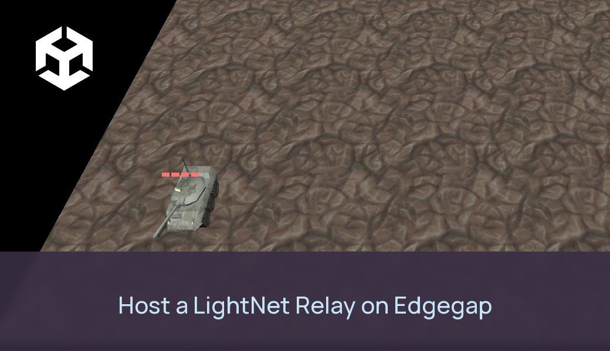

# Small network relay with game sample using Mirror, FishNet, PurrNet or NGO



A small network relay built on [LightNet](https://github.com/edgegap/server-sample-unity-smart-relays) that runs in a Docker container (and so on Edgegap), and Mirror's Tanks sample playing through it on **Mirror, FishNet, PurrNet or Netcode for GameObjects (NGO)**: one setting picks the netcode. One player hosts a room and gets a 6-letter code; the other joins with the code. Neither game opens a port: both are clients of the relay.

| Folder | What it is |
|---|---|
| `LightNet/` | LightNet core as a Unity package (`com.lightnet.relay`), with fixes for running as a relay (see below), plus `Runtime/Relay/`: the relay protocol and `RelayPeer`, the netcode-agnostic client of the relay. |
| `relay-server/` | The relay: a .NET 8 console app built from the same LightNet sources, and its Dockerfile. |
| `tanks/` | Unity 6 project (6000.0.54f1) from [edgegap/netcode-game-sample-unity-mirror-tanks](https://github.com/edgegap/netcode-game-sample-unity-mirror-tanks) with `Assets/Tanks/`: the game on all four netcodes. |
| `e2e.sh` | Automated test: two Tanks clients through the relay, on each netcode. |
| `matchmaker-config.json`, `e2e-matchmaker.sh` | Optional [Edgegap matchmaker](#optional-edgegap-matchmaker) config, and its automated test. |

## Pick the netcode

The netcode is the `netcode` field of **`tanks/Assets/Tanks/Resources/TanksSettings.asset`** (`Mirror`, `FishNet`, `PurrNet` or `NGO`), which also holds the relay address and port. Three other ways to swap it:

- Editor menu **Tanks > Netcode > Mirror / FishNet / PurrNet / NGO**: sets the asset and opens that netcode's scene.
- In the game, before hosting or joining: the netcode buttons at the top of the HUD.
- Command line: `-netcode FishNet`.

Host and players must use the same netcode. One build contains all four.

| Netcode | Version | Relay transport | Tank sync |
|---|---|---|---|
| Mirror | 66.0.9 (in `Assets/Mirror`) | `MirrorRelayTransport` | `[SyncVar]`, `[Command]`, `[ClientRpc]`, client-authoritative `NetworkTransform` |
| FishNet | 4.7.4 (in `Assets/FishNet`) | `FishNetRelayTransport` | `SyncVar<int>`, `[ServerRpc]`, `[ObserversRpc]`, client-authoritative `NetworkTransform` |
| PurrNet | 1.24.1 (UPM, git) | `PurrNetRelayTransport` | `SyncVar<int>`, `[ServerRpc]`, `[ObserversRpc]`, owner-authoritative `NetworkTransform` |
| NGO | 1.13.0 (UPM) | `NgoRelayTransport` | `NetworkVariable<int>`, `[ServerRpc]`, `[ClientRpc]`, owner-authoritative `NetworkTransform` with unreliable deltas |

## How the project is laid out

```
Assets/Tanks/
  Core/       netcode-free: TanksSettings, TankCore (input, movement, turret, health bar, hits),
              ProjectileCore, TankSpawnPoint, ITanksSession, TanksGame (HUD, command line, e2e test)
  Mirror/ FishNet/ PurrNet/ NGO/
              per netcode, in its own assembly: <Netcode>RelayTransport, <Netcode>Tank,
              <Netcode>Projectile, <Netcode>Session, Prefabs/Tank + Projectile
  Scenes/     Boot (loads the selected netcode's scene), Tanks_Mirror, Tanks_FishNet, Tanks_PurrNet, Tanks_NGO
  Editor/     TanksSetup (generates the scenes and prefabs), TanksBuild
```

The gameplay is Mirror's Tanks example split in two: `TankCore` has no netcode, and the netcode component next to it (`ITankNet`) syncs health, fire and despawn. The four scenes and prefab sets are generated from Mirror's example scene and prefabs by **Tanks > Regenerate netcode scenes and prefabs**; run it again after changing them.

The four relay transports all wrap `RelayPeer`. On the host, the netcode's own client never goes through the relay: NGO and Mirror handle it themselves, and the FishNet and PurrNet transports loop it back in-process.

## How the relay works

```
 Tanks (host: server + client) ──TCP+UDP──►  LightNet relay (Docker)  ◄──TCP+UDP── Tanks (client)
   CreateRoom → code                           room CODE: host + clients            JoinRoom CODE
   ToPeer(id, data)  ─────────────────────────► FromHost(data) ─────────────────────►
   ◄──────────────────────── FromPeer(id, data) ◄──────────────────────────────────── ToHost(data)
```

- Reliable messages go over LightNet's TCP channel and unreliable ones over its UDP channel. The relay forwards each message on the channel it arrived on.
- The relay is not a game server: the hosting player's game runs the netcode's server, and the relay only forwards bytes between the host and each client. The relay doesn't know or care which netcode is used.
- When the host leaves, the room closes and the relay disconnects its clients.
- Limits per message: 1,177 bytes unreliable, 16 KB reliable. The transports report these as their MTU.
- Players can also reach the relay over one WebSocket instead of TCP + UDP (below); both kinds of players can share a room.

## Security

**Game traffic through the relay is not encrypted by default.** It goes over LightNet's plain TCP and UDP, so anyone on the network path can read it. Calls to the Edgegap matchmaker are HTTPS.

What protects players today:

- Nobody sees another player's IP address: everyone connects out to the relay.
- With room codes, anyone with the relay address and a valid code can join. With the [matchmaker](#optional-edgegap-matchmaker), the relay only gives each room's code to that room's tickets.

**For encryption, use the WebSocket option.** On Edgegap, a `WS` port with **TLS Upgrade** makes it `wss://`: Edgegap holds the certificate and terminates TLS, so traffic between each player and Edgegap is encrypted and the relay needs no certificate. It is not end to end: the relay, and so its operator, still sees the bytes it forwards, and the host's game sees everything, as with any relay.

The trade-off: WebSocket runs over TCP only, so "unreliable" messages are sent reliably and in order. On a lossy connection that adds delay, which is fine for co-op and turn-based games, less so for fast shooters. So it is an option next to TCP + UDP, not a replacement, and a host on TCP + UDP and a client on WebSocket can play in the same room.

Use it by giving the game a `ws://` or `wss://` relay address instead of a host name (`TanksSettings.asset`, the HUD, or `-relay wss://<host>.pr.edgegap.net:<external port>`); with the matchmaker, turn on `matchmakerUseWebSocket` (`-matchmakerWebSocket`). It works on desktop and mobile builds (.NET `ClientWebSocket`); a WebGL build would also need a browser WebSocket bridge, which the sample doesn't have yet.

## Run it

Requirements: Docker, Unity 6000.0.54f1, .NET 8 SDK (only to build the relay outside Docker).

```bash
docker build --platform linux/amd64 -f relay-server/Dockerfile -t lightnet-relay:dev .
docker run --rm -p 7777:7777/tcp -p 7777:7777/udp -p 7778:7778/tcp lightnet-relay:dev
```

Open `tanks/` in Unity, pick a netcode (above) and press Play on `Assets/Tanks/Scenes/Boot.unity` (or open a `Tanks_<Netcode>` scene directly), or build with **Tanks > Build Windows client**. In the first game press **Host**: the room code appears in the HUD. In the second, type the code and press **Join room**.

Automated test: it runs on Windows (from Git Bash) and needs the Windows client build first, made in Unity with **Tanks > Build Windows client** (`tanks/Builds/Windows/Tanks.exe`, not in the repository). With the relay running, test all four netcodes or name some:

```bash
./e2e.sh 127.0.0.1 7777
./e2e.sh 127.0.0.1 7777 FishNet NGO
./e2e.sh ws://127.0.0.1:7778 0                               # both games over WebSocket
CLIENT_RELAY=ws://127.0.0.1:7778 ./e2e.sh 127.0.0.1 7777     # host on TCP + UDP, client on WebSocket
```

For each netcode it starts a host and a client. The client drives in circles and fires every second. It passes when both games see two tanks, both received reliable and unreliable data through the relay, both saw a projectile spawn, and the host saw the client's tank move.

Relay settings (environment variables): `RELAY_TCP_PORT` and `RELAY_UDP_PORT` (default 7777), `RELAY_WS_PORT` (WebSocket, default 7778, 0 = off; other HTTP requests on it get `200 ok` for health checks), `RELAY_MAX_PEERS` (default 256), `RELAY_IDLE_EXIT_SECONDS` (exit when no room exists for that long, default 600, so an idle deployment on Edgegap stops; 0 = never).

Game command line: `-netcode NAME -relay ADDRESS -relayPort PORT [-relayUdpPort UDP]` (or `-relay ws://HOST:PORT` / `wss://HOST:PORT`), then `-host [-codeFile PATH]` or `-join CODE`; for tests, `-e2e -expectTanks N -timeout S` and `-switchFrom NAME` (start on another netcode and switch at runtime).

## Optional: Edgegap matchmaker

Off by default. With it on, players press **Find Match** instead of passing room codes around: the [Edgegap matchmaker](https://docs.edgegap.com/learn/matchmaking) groups 2 to 4 players near each other and starts a relay on Edgegap for their match, near them. Each player then asks that relay for its role with its matchmaking ticket ID: the first one hosts the match room, the others join it, and each netcode starts exactly as with a hand-made room. Players who search later join running rooms, and a relay with full rooms opens new ones before the matchmaker starts another relay. Hosting and joining by code still work next to it.

```
 Find Match ──ticket (+ pings)──► Edgegap matchmaker ──match──► deploys a relay (MM_TICKET_IDS = the matched tickets)
 ◄──── HOST_ASSIGNED: relay IP + port ────┘
 MatchRole(ticket) ──► relay: the room's first ticket → host + room code, others → join + room code (unknown tickets refused)
 host: CreateRoom(code) / others: JoinRoom(code), held until the host's room exists
```

The relay switches to match mode by itself when it finds `MM_TICKET_IDS`, which only the matchmaker injects. In match mode every room on it is a match room that only its own tickets can enter. Any other relay works as before.

### One relay, several rooms (backfill)

A match relay keeps working for the matchmaker after its first match starts, through [backfills](https://docs.edgegap.com/learn/matchmaking/matchmaker-in-depth): tickets owned by the relay that carry its own address. When the matchmaker puts a player in one, that player gets `HOST_ASSIGNED` with this relay and asks for its role like the others. The game needs nothing extra: the same Find Match flow.

- **Rooms with free seats come first.** A room with fewer than `RELAY_MATCH_MAX_PLAYERS` (default 4) players, in the room or on their way, keeps up to 3 backfills open; a player placed there joins that room.
- **Then new rooms.** When every room is full and the relay has fewer than `RELAY_MAX_ROOMS` (default 4) rooms, it offers one new room. The player placed there hosts it, and the room then fills like the others. The relay only offers a new room once the others are full, so two players searching at the same time end up together instead of alone in two rooms.
- **Near players only.** Backfills carry the room's own players' tickets, with their pings, so the matchmaker checks a new player against them with the profile's latency rule.
- **A host left alone** for `RELAY_SOLO_ROOM_SECONDS` (default 120) is told (`RoomTimedOut`): the game stops hosting and searches again by itself.
- **The relay stops when its last room ends**, not when one host leaves. It deletes its backfills first, so no player is sent to a relay that is gone, and stops its own deployment (`ARBITRIUM_DELETE_URL`). A room whose host never arrives is dropped after 60 s.
- **Rate limits.** At most 5 backfills open per relay, created at least 0.3 s apart (backfill creation is limited to 5 per second on the free tier), with a pause after an error.

```
 relay (a room has free seats, or all are full) ──POST /backfills (its address + the room's tickets)──► matchmaker
 late player: Find Match ──ticket──► matchmaker puts it in a backfill ──► HOST_ASSIGNED: this relay
 relay sees the backfill ASSIGNED (polls every 2 s) → seat in that room, or a new room → MatchRole → joins / hosts
```

The profile in [`matchmaker-config.json`](matchmaker-config.json) is built for it:

- for its first 10 seconds a ticket can only go into a backfill (`min_team_size` 9999), so a player who searches while a relay has room joins it; after 10 seconds the usual rule applies and 2 to 4 waiting players get a new relay;
- the `beacons` rule (`latencies`: at most 150 ms to a beacon, at most 100 ms apart) keeps players, and backfills, with players near them. Each ticket carries the game's pings to Edgegap's beacons (`matchmakerLatencyBeacons` in `TanksSettings.asset`, on by default; browsers can't ping, so a WebGL build needs a profile without this rule).

Backfill needs two variables on the app version: `MATCHMAKER_URL` and `MATCHMAKER_TOKEN` (the matchmaker's API URL and Auth Token, the same client-safe values the game uses). Without them the relay logs `backfill: off` and its rooms never take late players. The code is in `relay-server/MatchBackfill.cs` and `relay-server/RelayServer.cs`, following the Edgegap Unity SDK's backfill flow.

Set it up:

1. Push the relay image and create an app version as in [On Edgegap](#on-edgegap), with the port named `relay`.
2. In the Edgegap dashboard, **Matchmaker > Create Matchmaker**: upload [`matchmaker-config.json`](matchmaker-config.json) (matchmaker 3.3.3, profile `casual`, 10 s for backfill first, then 2 to 4 players, latency rule, 30 s ticket expiration) after setting `application.name` and `version` to your app version, then **Create and Start**.
3. For backfill, add `MATCHMAKER_URL` and `MATCHMAKER_TOKEN` (the matchmaker's API URL and Auth Token) as environment variables on the app version. Optional: `RELAY_MATCH_MAX_PLAYERS`, `RELAY_MAX_ROOMS`, `RELAY_SOLO_ROOM_SECONDS`.
4. In `tanks/Assets/Tanks/Resources/TanksSettings.asset`, turn on `useMatchmaker` and paste the matchmaker's **API URL** and **Auth Token** (the token is safe to ship in a game: it gives no access to the Edgegap account). Or, on the command line: `-matchmaker URL -matchmakerToken TOKEN`, and `-findMatch` to search at start.

The client uses the [Edgegap Unity SDK](https://github.com/edgegap/sdk-unity-sessions-matchmaker-server-browser) (`com.edgegap.unity-sdk`); the code is in `Assets/Tanks/Core/TanksMatchmaker.cs`.

Automated test: games press Find Match and play through the relay the matchmaker started, on each netcode in turn (Windows, Git Bash, Windows client build needed as above):

```bash
./e2e-matchmaker.sh https://<id>.edgegap.net <matchmaker token>
./e2e-matchmaker.sh https://<id>.edgegap.net <matchmaker token> FishNet NGO
MM_WEBSOCKET=1 ./e2e-matchmaker.sh https://<id>.edgegap.net <matchmaker token>   # over wss:// (relay-ws port)
BACKFILL=1 ./e2e-matchmaker.sh https://<id>.edgegap.net <matchmaker token>       # + a late third player, by backfill
MULTIROOM=1 ./e2e-matchmaker.sh https://<id>.edgegap.net <matchmaker token>      # fill a room, then a 2nd room on the same relay
```

`MULTIROOM=1` starts the first room's players (`ROOM_SIZE`, default 4, the relay's `RELAY_MATCH_MAX_PLAYERS`), then two more games: the first must host a new room on the same relay and the second must join it. The first room stays up after the second has played, so the relay must keep running when one room ends. `EXTRA_ARGS="-beacons Tokyo=20"` gives the games fixed pings instead of measured ones.

Tested on Edgegap on 2026-11-02 (matchmaker 3.3.2, free tier): passed on Mirror, FishNet, PurrNet and NGO, one relay deployment per match in Newark, each stopped by the relay itself (`TERMINATED`) when the host left. Later the same day with backfill and the 3.3.3 config above: `BACKFILL=1` passed on all four netcodes over TCP/UDP and over `wss://` (`MM_WEBSOCKET=1`): two players started a match, a third pressed Find Match once it ran and joined it through the relay's backfill, all three saw three tanks, and each relay stopped itself. With the multi-room relay and the latency rule (version `20261102-1815`, real pings from Montreal): `BACKFILL=1` passed again on all four netcodes over TCP/UDP and `wss://`, and `MULTIROOM=1` passed on all four: four players filled the first room through backfills, the next player hosted a second room on the same relay and the one after joined it, the second room ended while the first kept playing, and the relay stopped itself after the last room. A game with fake Asia-only pings was never put in the running room (its ticket expired) while a nearby player who searched next joined it.

## Changes to LightNet

Upstream LightNet assumed a server that can reach its clients directly. To run as a relay behind Docker or Edgegap port mapping:

- **UDP works through NAT.** Upstream, the server sends UDP to a port on the client (base port + n), which NAT and firewalls block. Now the client sends and receives on one UDP socket and sends its handle every second; the server answers to the address those datagrams come from.
- **No Unity dependency in the core.** `ASSERT`/`CLAMP` no longer call UnityEngine, so the same sources build the .NET relay. Before, `ASSERT(FreeUnreliablePorts.TryDequeue(...))` also skipped the dequeue in Unity release builds, where `Debug.Assert` calls are compiled out.
- **Runs on .NET 8.** `Thread.Abort` (not supported there) is guarded.
- **No busy loops.** Network threads sleep 1 ms between polls instead of spinning a core each.
- **Other fixes.** TCP no-delay is on, receive buffers are 64 KB, a full server refuses connections instead of asserting, slots are freed on connection loss, a closing peer flushes its Disconnect, and the random packet-loss emulation is skipped when off (`System.Random` is not thread safe).

## Notes on having four netcodes in one project

- PurrNet needs Unity 2022.3 or newer, so the project moved from 2021.3 to Unity 6000.0.54f1.
- Mirror's `SimpleWebTransport` (WebSocket transport, unused here) was removed: PurrNet ships an assembly with the same name.
- FishNet is in `Assets/FishNet` rather than installed as a package: some of its code-generation files share GUIDs with NGO's, which Unity can only fix outside a read-only package. Its Yak transport, which doesn't compile at tag 4.7.4, was left out (see `Assets/FishNet/VERSION.txt`).
- `com.unity.transport` is pinned to 2.6.0, which PurrNet's optional UTP transport needs.
- Each netcode's code is in its own assembly that references only that netcode, so each code generator only processes its own code.

## On Edgegap

The app version needs one port: 7777 with protocol `TCP/UDP` (two separate 7777 TCP and 7777 UDP entries are rejected as duplicates). Edgegap maps both protocols to the same external port, so clients pass it once: `-relay <host>.pr.edgegap.net -relayPort <external port>`. Edgegap's readiness check opens a TCP connection at start, which shows in the relay log as a peer that connects and leaves.

For the [WebSocket option](#security), add a second port: 7778, protocol `WS`, **TLS Upgrade** on, named `relay-ws`. Players connect to `wss://<host>.pr.edgegap.net:<its external port>`, by host name (the certificate is for `*.pr.edgegap.net`, not the IP). Tested on Edgegap on 2026-11-02: `./e2e.sh wss://<host>.pr.edgegap.net:<port> 0` and the mixed test (`CLIENT_RELAY`) passed on all four netcodes.

Tested on Edgegap on 2026-10-29: `./e2e.sh <host>.pr.edgegap.net <port>` through a relay deployed in Newark passed on Mirror, FishNet, PurrNet and NGO. One deployment serves many rooms, with room codes or through the matchmaker (several match rooms per relay, above).

The `tanks/` project comes from commit `01d82b3` of edgegap/netcode-game-sample-unity-mirror-tanks.

## License

Apache License 2.0 (see [LICENSE](LICENSE)), the license of LightNet. Third-party code keeps its own license: Mirror (MIT, `tanks/Assets/Mirror`), FishNet (`tanks/Assets/FishNet/LICENSE.txt`) and ParrelSync (`tanks/Assets/ParrelSync/LICENSE.md`) in the project; PurrNet and NGO are installed as packages under theirs.
